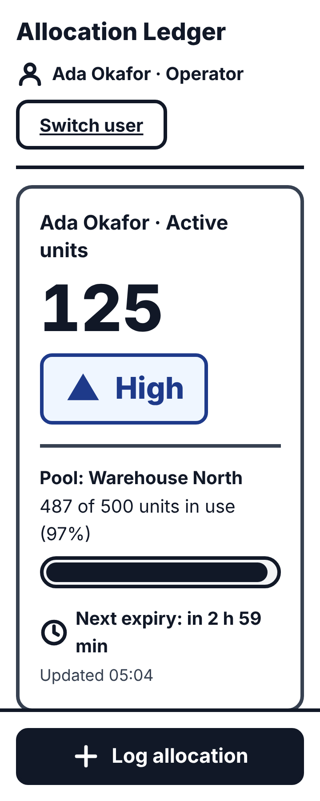
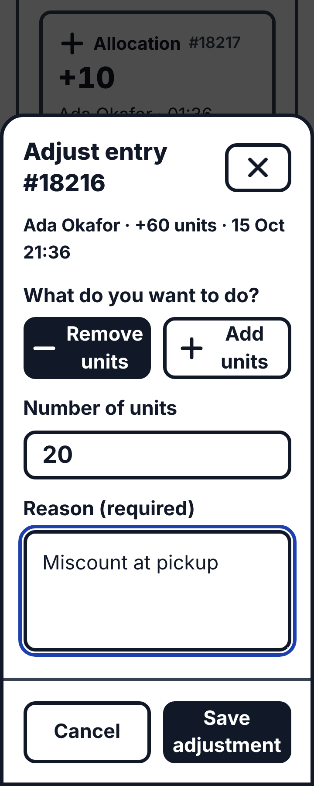
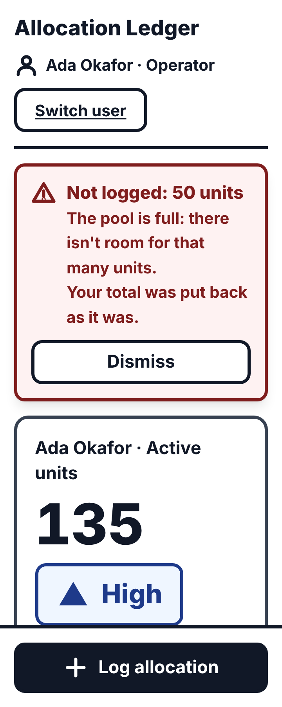
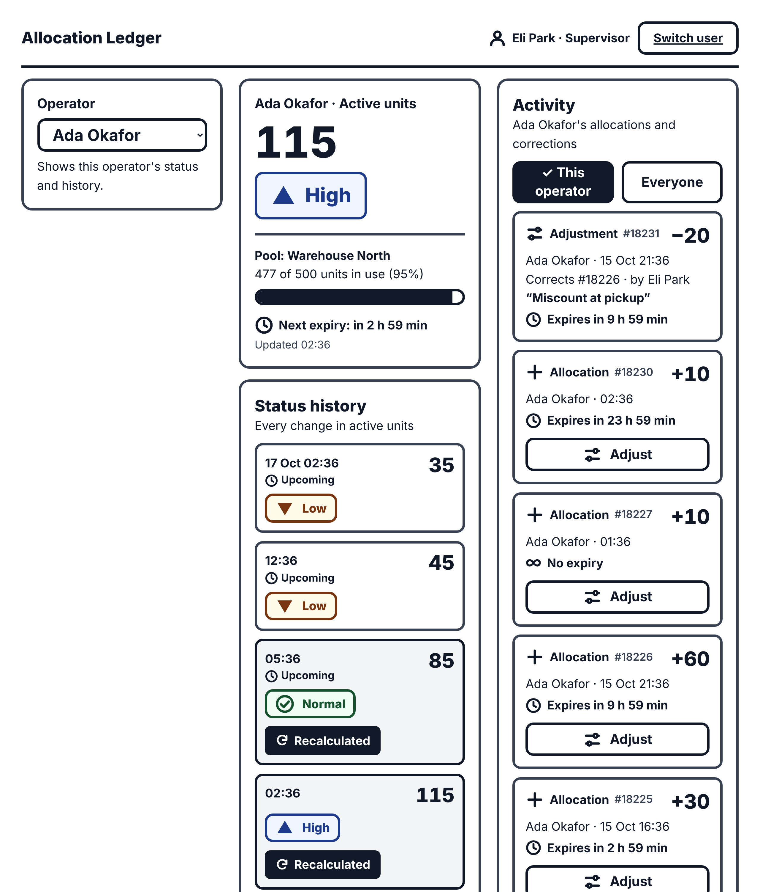

# Allocation Ledger

Field operations module. Operators log resource allocations from their phones; allocations add to a shared unit pool; each operator's running total sets a status level (critical / low / normal / high); some allocations expire, depending on the operator's tier; supervisors correct past entries. It is built for phones in a bright warehouse, worn with gloves: big numbers, big buttons, high contrast.

This is a **first version**. It is meant to be run, poked at, and challenged. The numbers the client still has to confirm are listed in [Assumptions to confirm](#assumptions-to-confirm-with-the-client).

<p>
  
  
  
</p>

**Short on time?** Read the [Trade-Off Document](docs/TRADE-OFFS.md): the ambiguities we found in the brief, our assumptions, and why the database and screen are designed this way.

**Contents:** [Run it](#run-it-one-command) · [Try it in 10 minutes](#try-it-in-10-minutes) · [Key decisions](#key-decisions) · [Concurrency test result](#concurrency-test-result) · [Assumptions to confirm](#assumptions-to-confirm-with-the-client) · [Trade-offs](#trade-offs-in-this-first-version) · [Next steps](#next-steps) · [Reference](#reference)

## Run it (one command)

You need **Docker** (for Postgres) and **Node 22+**.

```bash
git clone <this repository> && cd allocation-ledger
npm install
npm run demo
```

`npm run demo` creates `.env`, starts Postgres 16 in Docker, applies the migrations, loads demo people and past entries, and starts the app on **http://localhost:3000**. It is safe to run again. To start from nothing: `docker compose down -v`, then `npm run demo`.

In the demo, tier **T1 entries expire after 2 minutes** (the real value is 24 hours; the shortened one is only so you can watch expiry happen). Press **Switch user** on the first screen and pick someone:

| Person | Role | Tier (expiry) |
| ------ | ---- | ------------- |
| Ada Okafor, Ben Lindqvist | operator | T1 (2 min in the demo, 24 h for real) |
| Chidi Mensah | operator | T2 (72 h) |
| Dee Navarro | operator | T3 (never) |
| Eli Park | supervisor | n/a |

The "Switch user" screen is a temporary stand-in for login (see [Trade-offs](#trade-offs-in-this-first-version)).

## Try it in 10 minutes

### 1. Two tabs submitting at once

1. Pick **Dee Navarro** (tier T3, so nothing expires and the numbers stay put). Open the app in **two browser tabs** and note the number, say 120.
2. In tab A type `10`, in tab B type `5`, and press **Log allocation** in both at the same moment.
3. Each tab shows its new total at once, with a dashed **Syncing…** row until the server confirms. For a moment each tab may know only about its own write (tab A at 130, tab B at 125). Within 3 seconds (the next poll) **both tabs agree on 135**. Nothing was lost and nothing was counted twice.
4. Check the books in the database: the pool's cached balance must equal the sum of the ledger.

```bash
docker compose exec db psql -U postgres -d allocation_ledger -c \
  "select p.name, p.balance, sum(e.units) as ledger_sum from pool p join ledger_entry e on e.pool_id = p.id group by p.id"
```

That is a small version of what the [concurrency test](#concurrency-test-result) does with 50 writers.

### 2. A supervisor corrects a past entry

1. **Switch user** to **Eli Park** (supervisor). The **Operator** picker on the left chooses whose numbers you see. Choose **Dee Navarro**: the log shows only Dee's entries (the **Everyone** button widens it to the whole pool).
2. On the `+35` row press **Adjust**, choose **Remove units**, enter `15`, give a reason ("Entered 35, actual was 20"), and press **Save adjustment**.
3. Dee's total drops by 15 at once. In **Status history**, the points from that entry onward are marked **Recalculated** for a few seconds (3 of them here); earlier points are untouched. The log now has an **Adjustment** row ("Corrects #17, by Eli Park") next to the original, which is still there: the original is never edited.
4. Try to remove more than the entry ever had (for example 60 from a 35-unit entry): it is refused, because an entry's net units can never go below zero.
5. Try to change the ledger by hand: `docker compose exec db psql -U postgres -d allocation_ledger -c "update ledger_entry set units = 1 where seq = 1"` is rejected by the database itself (`ledger_entry is append-only`).



### 3. A T1 entry expires after 2 minutes

1. **Switch user** to **Ada Okafor** (tier T1). Log `30`. The row says **Expires in 1 min** (it counts down; the stored window is exactly 2 minutes) and the metric card shows **Next expiry**.
2. Do nothing. Two minutes after you logged it, the number drops by 30 and the status changes **at that moment**, not at the next poll. (In our run: `Low 30` became `Critical 0` after 120.7 s while the screen polls only every 3 s. The server tells the screen exactly when the next entry expires and the screen refetches at that instant.)
3. The entry is still in the log, marked **Expired**: expiry changes what counts, never what happened. Ada's older demo entries may already have expired; the numbers you see depend on when you started.

Bonus: to see the capacity rule, set a limit a little above the pool's current "units in use" (shown on the metric card; 300 is an example) and try to log more than fits:

```bash
docker compose exec db psql -U postgres -d allocation_ledger -c "update pool set capacity = 300 where name = 'main'"
```

The allocation is refused ("The pool is full"), the optimistic number rolls back, and a red notice explains why.

## Key decisions

Four ideas carry the whole design. Everything else is ordinary web app.

### 1. The ledger is append-only; corrections are new rows

The `ledger_entry` table is never updated or deleted, and a database trigger enforces it (so a bug or a stray SQL statement can't rewrite history). A supervisor's correction is a new `ADJUSTMENT` row, with a signed `units`, a required `reason`, and `refSeq` pointing at the entry it corrects. It is dated at the original entry's time and expires with it, so it changes the history from that moment on and nothing before it. Rows are ordered by `seq`; `effectiveAt` is when it happened in the field, `recordedAt` is when the server saw it. The pool also keeps a cached `balance`, changed only by `balance = balance + n` in the same transaction as the insert.

### 2. One row lock per pool, taken before anything is checked

Every write is one Postgres transaction that first runs `SELECT … FOR UPDATE` on its **pool row**. Two writers to the same pool queue up behind each other; writers to different pools don't interact. Only then does it check the idempotency key, check capacity (or "not below zero" for an adjustment), insert the row and increment the balance. Checking *after* taking the lock is the whole point: the check sees everything the previous holder committed, so two requests can't both see "there is room" and both take it. A write that waits more than 3 s for the lock (or runs more than 5 s) gets `503 BUSY` with `Retry-After: 1`; nothing was written, so retrying is safe. The lock also keeps `seq` in commit order within a pool. Code: [`src/server/allocate.ts`](./src/server/allocate.ts), [`src/server/adjust.ts`](./src/server/adjust.ts), [`src/server/ledger-tx.ts`](./src/server/ledger-tx.ts).

### 3. Every write carries an idempotency key

Phones lose signal. The client makes a random key **once** per action (`Idempotency-Key` header) and re-sends the *same* key on every retry. The key is unique per creator in the database, so a retry returns the original entry (`200`, `"replay": true`) and is never counted twice, even if the first attempt actually landed and only the answer was lost. The same key with a different request is a `409`. If five identical requests arrive at once, the lock and the unique index together leave exactly one row. On screen: a send with no answer stays as a **Not sent** row with **Retry**; a refusal (pool full) is rolled back with a notice and offers no Retry, because retrying can't help.

### 4. Status and history are computed from the ledger when read

Nobody stores "this entry made Ada go from Low to Normal". The running total, the status and the history timeline are **derived on read** by pure functions in [`src/domain/`](./src/domain) (active units, status cutoffs, timeline), from the ledger and an injected "now". So a retroactive correction needs no recalculation job: the next read simply gives the new answer, and the supervisor's screen can show exactly which points moved. The one thing computed once and then frozen is an entry's **expiry date**: it is calculated at creation from the operator's tier *at that time* and stored on the row, so changing a tier's expiry later never rewrites old entries. An entry counts from `effectiveAt` up to, but not including, `expiresAt`.

## Concurrency test result

[`src/server/concurrency.int.test.ts`](./src/server/concurrency.int.test.ts) is the guarantee test. It sends real HTTP requests to the real handlers, against real Postgres (nothing mocked), in the same tick so they genuinely collide, and repeats each scenario in 5 rounds on fresh pools. For the overflow scenario a second connection watches the pool balance *during* the run, not just at the end.

| Scenario (5 rounds each) | With the row lock | Lock removed |
| ------------------------ | ----------------- | ------------ |
| **1.** 50 parallel allocations: pool balance equals the sum of the ledger, all 50 land | 5/5 pass | 5/5 pass |
| **2.** 20 parallel allocations on a nearly full pool (capacity 100, 90 used): never above capacity | 5/5 pass | **0/5**: 15 to 20 of the 20 accepted where only 1 to 3 fit |
| **3.** the same idempotency key 5 times at once: exactly one row | 5/5 pass | 5/5 pass |
| **4.** two supervisors adjust the same entry at once, each fine alone but below zero together: exactly one succeeds | 5/5 pass | **0/5**: both succeed (`201, 201`), the entry goes negative |
| **Total** | **20/20**, three runs in a row, about 5 s per run | **10/20 fail** |

**"Without `FOR UPDATE` it fails" is a check we actually ran**, not an assumption: we deleted ` FOR UPDATE` from `lockPool()` in `src/server/ledger-tx.ts`, ran the suite, and put it back. In the failing rounds, for example, 20 requests were accepted where only 2 fit (`expected 20 to be 2`) and 15 where only 1 fit. Scenarios 1 and 3 still pass without the lock, and that is expected and reassuring: the atomic `balance = balance + n` keeps the sum right, and the unique index on `(created_by_id, idempotency_key)` is a second line of defence. The lock is what protects the two **check-then-write** rules: capacity, and "an entry never goes below zero".

To reproduce:

```bash
docker compose up -d --wait
npm run test:int -- src/server/concurrency.int.test.ts        # 20 passed
# now delete " FOR UPDATE" in lockPool() (src/server/ledger-tx.ts) and run it again: 10 fail
git checkout src/server/ledger-tx.ts                           # put it back
```

Around it: 335 unit tests (no database), 146 integration tests (real Postgres, in a separate `ops_test` database so they can never touch your data), and 40 real-browser checks at phone and desktop sizes (`npm run ui:check`). A pre-commit hook compares per-file test counts with the last commit, so a silently deleted test fails the commit (see [Reference](#reference)).

## Assumptions to confirm with the client

We decided these while building. Every one of them is a one-line change, but they are the client's to confirm.

### Numbers (placeholders)

| What | Our default | Where it lives |
| ---- | ----------- | -------------- |
| **Status cutoffs**, on *active* (non-expired) units: critical < 20, low 20 to 49, normal 50 to 99, high 100 and above | as given | [`src/domain/status-config.ts`](./src/domain/status-config.ts) (plus the boundary tests in `status.test.ts`) |
| **Expiry per tier**: T1 24 h, T2 72 h, T3 never | as given | the `tier` table (`expiry_minutes`), changeable without a deploy; seeded by [`prisma/seed.mjs`](./prisma/seed.mjs) |

### Rules we had to decide

1. **Capacity (needs a decision).** A pool's `capacity` is measured in **active** units (the same measure as operator status), **not** in the cached `balance`. `balance` also counts expired units, so using it would keep blocking people for units that no longer exist. The active total is computed from the ledger inside the pool lock, so concurrent requests can't overshoot. When an allocation would exceed capacity we **reject it (422)** rather than warn; reaching capacity exactly is allowed. **Question for the client:** reject or warn? And is capacity per pool, as modelled? (Pools with no capacity set, like the demo pool, have no limit.)
2. **Expiry is counted from when it happened** (`effectiveAt`), not from when the server recorded it, and an entry counts up to but not including its expiry instant.
3. **Who may do what.** Only operators log allocations (for themselves); only supervisors adjust. A supervisor sees and adjusts only their **own pool**; anything else is `403`, including an operator id that doesn't exist, so ids can't be probed. Only an allocation can be adjusted, not an adjustment (adjust the original again).
4. **Corrections.** An adjustment is dated at the original entry's time and expires with it. An entry's net units (original plus all adjustments) can't go below zero (exactly zero is fine). An adjustment that would *add* active units is capacity-checked; one that removes units, or touches an already-expired entry, is always allowed, even in a pool that is over capacity.
5. **Two history views.** Supervisors see every balance change; operators see only the points where their status changes (the first point is always shown).
6. **"Metric"** is our reading of the client's word: the operator's active units and status, plus their pool's capacity, active units and lifetime balance. Is that what they want to see?
7. **Time zone.** Times are shown in one fixed zone (`APP_TIMEZONE`, default UTC), not the phone's, so every screen agrees.
8. **Timeouts.** A write that waits more than 3 s for the pool lock, or runs longer than 5 s, returns `503 BUSY` (safe to retry with the same key).

## Trade-offs in this first version

- **Polling instead of server push (SSE).** Each open screen asks for its numbers every 3 s (every 30 s when the tab is hidden), plus once more at the exact moment the next entry expires. That is simple, survives any proxy, and needs no connection state, at the price of up to ~3 s staleness and about two small requests per open screen every 3 s (size the database pool for that). While your own write is in flight we **pause polling**, because a poll that lands between the server's commit and its answer would count the new entry twice. That stop-gap has a cost: the screen doesn't refresh for those moments. The proper fix is to **reconcile by `seq`**: ignore any server data older than the last confirmed write. That also fits the SSE upgrade later, where pushed events carry a `seq` too.
- **Simple, temporary auth.** The "session" is a `uid` cookie and a *Switch user* screen (on only when `ENABLE_USER_SWITCHER=true`; off by default, and `POST /api/switch-user` is a 404 when off). **It identifies people, it does not authenticate them: anyone can set that cookie.** Do not expose it with real data. Every endpoint gets "who is calling" from one function, `requireUser()` in [`src/server/api/auth.ts`](./src/server/api/auth.ts), which is the single place to replace with real login.
- **No stored projections.** The only stored aggregate is the pool's cached `balance`. Status, history and "active units" are computed on read, which is what makes corrections trivially correct, but the cost grows with the ledger. We measured it on a small cloud VM with Postgres on the same machine, one operator, full history: the **metric** stays flat at about 20 to 35 ms from 1,000 to 100,000 entries (it uses an index on active entries); the supervisor's **full status history** takes about 30 ms at 1,000 entries, 90 ms at 10,000 and 1.5 s at 100,000 (a 2.5 MB response). A busy operator logging 50 entries a day reaches 10,000 in about seven months, so this is comfortable for a long time, and if it ever isn't, a snapshot of the timeline is a contained change (the ledger stays the source of truth).
- **Unsent entries live in the page.** A **Not sent** row (no network) is kept in memory with its idempotency key; reloading the page loses it. Persisting that queue is in the next steps.
- **Writes to one pool run one at a time.** That is the price of correctness (decision 2). The lock is held only for a few queries, which is fine for field logging, and different pools don't contend. (We haven't load-tested at the client's real volumes: see next steps.)

## Next steps

For the following iteration, roughly in order:

1. **Confirm the assumptions above with the client**, especially capacity (reject or warn), the status cutoffs and the tier expiries. Then freeze them.
2. **Real login**, replacing the user switcher behind `requireUser()`, and the **low-privilege database role**: the append-only trigger guards against code mistakes, but a superuser or the table owner can still disable it. The app should connect as a role that can only `SELECT` and `INSERT` on `ledger_entry` (and `UPDATE` the pool's balance), with `UPDATE`, `DELETE`, `TRUNCATE` and `TRIGGER` on the ledger revoked.
3. **Reconcile by `seq`, then SSE.** Drop the "pause polling during a write" stop-gap and push changes to open screens.
4. **Persist the unsent queue** (with its idempotency keys) on the device so a "Not sent" entry survives a reload or a dead battery.
5. **A pipeline**: run unit, integration (Postgres service container), browser and test-count checks on every push, and build the deployable image.
6. **Load test at the real shape** (how many operators per pool, how many pools) and, only if the numbers ask for it, a timeline snapshot.

## Reference

Everything above is enough to run and judge the system. The rest is for people working on it. Project rules for contributors (and for AI assistants) are in [`CLAUDE.md`](./CLAUDE.md).

### Development setup, tests and database

`npm run demo` does all of this for you. The same thing by hand, if you want the steps (or a dev server on your own database):

```bash
cp .env.example .env
docker compose up -d --wait      # Postgres 16 (dev + test databases)
npm install                      # also runs `prisma generate`
npm run db:migrate               # apply migrations
npm run db:seed:demo             # tiers + demo operators and entries (or db:seed for tiers only)
npm run dev
```

Checks: `npm run typecheck`, `npm run lint`, `npm test` (fast unit tests, no database needed).

**Lost tests.** `npm run test:count` runs both suites and compares the number of tests per file with the counts committed in `test-counts.json` (the last commit's version is the "before"). It fails if a file lost tests, a file disappeared, tests were turned into `.skip`, or the baseline is stale. The pre-commit hook in `.githooks/` runs it (`npm install` points git at it: `git config core.hooksPath .githooks`); a commit with no code staged skips it. After adding tests run `npm run test:count -- --update` and stage `test-counts.json`. A deliberate removal needs `ALLOW_TEST_REMOVAL=1 git commit` on top of the updated baseline, so the diff of `test-counts.json` records it. `SKIP_INT_COUNT=1` skips the integration suite (it needs Docker Postgres) and says so. A count can't tell which test a rename replaced; it catches deletions, not swaps.

Integration tests run against real Postgres, in a separate database (`TEST_DATABASE_URL`, `ops_test` by default, created by the Docker init script and migrated automatically): `npm run test:int`. They never touch the dev database, and a guard refuses to run unless the database name ends in `_test` and differs from `DATABASE_URL`. The ledger is append-only, so these tests can't clean up after themselves. Each test creates its own pool, tier and operator, and `ops_test` just grows. To reset everything: `docker compose down -v && docker compose up -d --wait` (this also recreates the dev database; re-run `npm run db:deploy && npm run db:seed:demo`). `src/server/concurrency.int.test.ts` holds the money-critical guarantees (50 parallel allocations, overflow attempts on a full pool, repeated idempotency keys, two supervisors adjusting one entry); run it repeatedly after touching the write path.

#### Database connection pool

`DATABASE_POOL_SIZE` (default `10`) is the maximum number of Postgres connections **one app instance** may hold. Size it so that *instances × pool size* stays well below Postgres's `max_connections` (default 100), leaving room for migrations and admin sessions. More connections do **not** make a single busy pool faster: writes to one pool run one at a time behind its row lock, and each waiting write holds a connection while it waits. If the pool is too small, requests queue for a connection and a write that waits more than 2 s gets `503 BUSY` (safe to retry); too large across many instances, and Postgres refuses connections. If the app runs as many short-lived instances (serverless), keep it small and put a connection pooler such as PgBouncer in front. A value that isn't a whole number >= 1 makes API requests fail with a 500 (the reason is in the server log). On a local database the whole concurrency suite, including 50 parallel writes, passes with a pool as small as 1, so start at the default and raise it only if you see `503 BUSY` while the database itself is idle.

#### Seeding

```bash
npm run db:seed        # tiers T1/T2/T3 only
npm run db:seed:demo   # tiers + demo people and 20 past ledger entries
```

Tier expiry is the same either way: **T1 = 24 hours, T2 = 72 hours, T3 = never** (see the defaults below). The one exception is for testing: with `SEED_SHORT_EXPIRY=true`, T1 is **2 minutes** instead, so you can watch expiry happen.

```bash
SEED_SHORT_EXPIRY=true npm run db:seed:demo
```

`db:seed:demo` adds 4 operators, 1 supervisor, and 17 allocations plus 3 supervisor adjustments in the `main` pool. Some entries are already expired when it runs (under the defaults, the oldest T1 and T2 entries; in short mode, nearly all T1 entries).

Both seeds are safe to run repeatedly. Tiers and people are upserted, ledger entries use fixed idempotency keys and are skipped if present, and the pool balance only grows by rows actually inserted. An entry's expiry is fixed when it is created, so `SEED_SHORT_EXPIRY` only affects demo entries inserted on that run. To start over with different settings, recreate the database:

```bash
docker compose down -v && docker compose up -d --wait
npm run db:deploy && SEED_SHORT_EXPIRY=true npm run db:seed:demo
```

Running a seed overwrites expiry for T1–T3, and the demo / short-expiry modes are refused when `NODE_ENV=production`. Never run a seed against production data.

### The screen

Open `http://localhost:3000`.

**Operators** (phone): the metric on top (active units as a 72px number with its status), the activity log below it, and a big **Log allocation** button pinned to the bottom edge. It opens a bottom sheet with a large numeric field, +1/+5/+10 buttons and a confirm button. **Desktop**: three columns: the form, the metric with its status history, the activity log.

**Supervisors**: an operator picker, the selected operator's full status history, and an activity log that shows **only that operator's entries** by default (so the entry to correct is right there, not buried under other people's rows). The **Everyone** toggle widens it to the whole pool; the choice is kept in the URL (`?operator=…&log=all`) and survives changing operator. The filter is the `operatorId` parameter of `GET /api/entries` (same-pool check, 403 otherwise). Every allocation row has an **Adjust** button, which opens a **bottom sheet** on a phone (buttons in thumb reach) and a centred dialog on a desktop: choose *Remove* or *Add* units, enter the amount and a required reason. The history then shows exactly which points were **Recalculated** (an adjustment is dated at the entry it corrects, so only that moment and later change; earlier points never do).

What you can rely on:

- **No loading state on first open.** The page is rendered on the server (`instant = false`, no Suspense fallback), so the first HTML response already contains the numbers. A test fetches it with JavaScript off.
- **Instant, and never wrong.** Logging shows the new total at once, with a visible **Syncing…** row (dashed border, hourglass) and a dashed "includes N still syncing" note on the metric. When the server confirms, its own figure (returned in the response) replaces the guess in a single update, so the number never dips or counts twice. Two different bad outcomes: if the **server rejects** it (pool full, not allowed), the row is removed, the total goes back to what it was, and a red notice says why ("Not logged: 600 units. The pool is full…"; it floats at the top until dismissed, and offers no Retry because retrying can't help). If there was **no answer** (offline, busy), the entry may still be valid, so the row stays as **Not sent** with a **Retry** button that re-sends with the *same* `Idempotency-Key`: it can never double count.
- **Fresh.** While the tab is visible it polls every 3 s (`UI_POLL_MS`), every 30 s while hidden, and refetches on focus. Separately, the metric endpoint returns `nextExpiryAt`, and the screen schedules a refetch for that exact moment (against a clock anchored to the server's, so a phone with a wrong clock still expires entries at the right time), so the number and status change when an entry expires, not at the next poll.
- **Status is never colour alone.** Every status is a colour *and* an icon with its own shape (octagon, down triangle, check circle, up triangle) *and* a word.
- **Warehouse design rules:** dark text on white, no light-grey text, 7:1 contrast or better (a unit test reads the real colour tokens and fails if one breaks the rule), text 16px or larger, buttons and inputs at least 56px tall.

#### Environment variables for the screen

| Variable | Default | Meaning |
| -------- | ------- | ------- |
| `ENABLE_USER_SWITCHER` | **off** (anything but `true`) | The temporary "Switch user" screen **and** `POST /api/switch-user`. With it off, the endpoint answers 404 and the page just says sign-in isn't available. `.env.example` sets it to `true` for local work. Keep it off anywhere real data lives. |
| `UI_POLL_MS` | `3000` | How often a visible screen polls (500 or more). |
| `APP_TIMEZONE` | `UTC` | The IANA time zone times are shown in (for example `Europe/Berlin`). It is fixed, not "the device's zone", so the server-rendered page and the browser print identical text. |

Each open screen makes about two small requests every 3 s (the metric and the newest page of the log). Keep that in mind when sizing the database pool for many simultaneous users.

#### Checking it in a real browser

`npm run ui:check` (needs `npm run build` first) starts the production server against the `ops_test` database and drives Chromium (via `playwright-core`) at a phone size and a desktop size. It checks layout order, that every control is at least 48px tall, the contrast of every piece of text, that statuses carry an icon and a word, first open with JavaScript off, logging with a held-open request (the number must show exactly `5` then `25`, never flicker or double count), a real rejection rolling the number back with an error, retry with the same key, that nothing spills out of its card (including text running past a block's edge; rows, history points, the adjust sheet, on phone and desktop), a poll landing mid-write (no double count, no erased row), double taps (one request), the narrowest phone (360px, a 7-digit total, a very long name, the sheets), the supervisor's log filter (default one operator, Everyone, paging, polling only into the right log) and the adjust bottom sheet's position and thumb reach, the supervisor's adjustment recalculating the history, and the exact-moment expiry refetch. Screenshots go to `./ui-check-output`.

`npm run docs:screenshots` (also needs `npm run build` first) regenerates the README pictures in [`docs/screenshots/`](./docs/screenshots): operator view, after a submit, the capacity-exceeded error, the supervisor's adjust sheet and the history after an adjustment, each at 360px and 1280px. It builds a fresh pool in `ops_test` for each size (the old one is renamed, since the ledger can't be cleaned up) and never touches the dev database.

### API

All endpoints return JSON, are never cached (`Cache-Control: no-store`), and take their identity from the session cookie.

#### Auth (temporary)

The "session" is a cookie `uid` holding a user id. `POST /api/switch-user` `{ "userId": "…" }` sets it for any existing user, **but only when `ENABLE_USER_SWITCHER=true`** (default off; the endpoint is 404 otherwise) (after `npm run db:seed:demo` try `demo_ada`, `demo_cho`, or the supervisor `demo_sup`). **Anyone can set that cookie to any id, so this identifies users but does not authenticate them.** Everything that needs "who is calling" goes through `requireUser()` in [`src/server/api/auth.ts`](./src/server/api/auth.ts), which is the one place to replace with real login.

#### Conventions

- Every `POST` that writes needs an **`Idempotency-Key`** header (any unique string, up to 200 characters). Resend the same key to retry safely: you get the original entry back (`200`, `"replay": true`) and nothing is counted twice.
- The operator / supervisor is the logged-in user, never a body field. `effectiveAt` and `expiresAt` are set by the server; a body that includes them is rejected.
- One shared error handler produces every error response: `{ "error": CODE, "message": … }`.

| Status | When |
| ------ | ---- |
| `400` | Invalid JSON / body / query (`INVALID_REQUEST` lists the fields), or a missing `Idempotency-Key` (`IDEMPOTENCY_KEY_REQUIRED`) |
| `401` | `UNAUTHENTICATED`: no cookie, or it names a user that doesn't exist |
| `403` | `FORBIDDEN` (wrong role, or reading an operator you may not see: another operator, another pool, or an id that doesn't exist) / `NOT_SUPERVISOR` / `TARGET_OTHER_POOL` (a supervisor adjusting an entry outside their own pool) |
| `404` | `TARGET_NOT_FOUND` (an adjustment's target entry), `SUPERVISOR_NOT_FOUND`, `OPERATOR_NOT_FOUND` |
| `409` | `IDEMPOTENCY_KEY_REUSED`: that key was used with a different request (compared: operator, kind, units, refSeq) |
| `422` | `CAPACITY_EXCEEDED`, `TARGET_NOT_ALLOCATION`, `ADJUSTMENT_BELOW_ZERO` (the entry's net units would go below zero) |
| `503` | `BUSY` with `Retry-After: 1`: the pool lock (3 s) or the whole transaction (5 s) timed out. Nothing was written; **retry with the same key** |
| `500` | `INTERNAL`: a fixed message only. The real error is logged on the server, never sent to the client |

#### Endpoints

| Endpoint | Who | What |
| -------- | --- | ---- |
| `POST /api/entries` `{ units }` | operators | Log an allocation for yourself. `201` created, `200` replay. The response is `{ replay, entry, metric }`: `metric` is your metric **after** this write, which the screen uses to replace its optimistic guess. |
| `POST /api/adjustments` `{ targetSeq, units, reason }` | supervisors | Adjust an earlier allocation in your own pool (signed, non-zero units; `reason` required; the entry can't drop below zero in total). The adjustment is dated at the target's `effectiveAt` and expires with it. `201` / `200`. The response also carries `metric` for the adjusted operator. |
| `GET /api/entries?cursor=&limit=&operatorId=` | everyone | Newest first, paged by `seq`. Response `{ entries, nextCursor }`; pass `nextCursor` back as `cursor`; `null` = last page. `limit` is 1–100 (default 20). Operators see their own entries, supervisors their own pool (or one operator in it with `operatorId`). |
| `GET /api/metric?operatorId=` | everyone | `{ asOf, operator: { activeUnits, status }, nextExpiryAt, pool: { capacity, activeUnits, lifetimeBalance } }`. `nextExpiryAt` is when the operator's active units next drop because an entry expires (or `null`). Supervisors may pass `operatorId` for an operator in their own pool. |
| `GET /api/operators/:id/timeline?view=` | operators (own), supervisors (own pool) | `{ points: [{ at, balance, status }] }`. `view=transitions` = only where the status changes (the operator default); `view=full` = every balance change (the supervisor default, 403 for operators). |
| `POST /api/switch-user` `{ userId }` | anyone | Temporary login, see above. 404 unless `ENABLE_USER_SWITCHER=true`. |

How the writes stay correct under simultaneous requests: see `allocate()` in [`src/server/allocate.ts`](./src/server/allocate.ts) and `adjust()` in [`src/server/adjust.ts`](./src/server/adjust.ts). In short, one READ COMMITTED transaction locks the pool row, then checks the idempotency key (after the lock, so it sees the previous holder's commit, and before the capacity check, so a replay is never refused for lack of space), then checks capacity, then inserts and increments the balance. The unique index on `(created_by_id, idempotency_key)` is the backstop.
